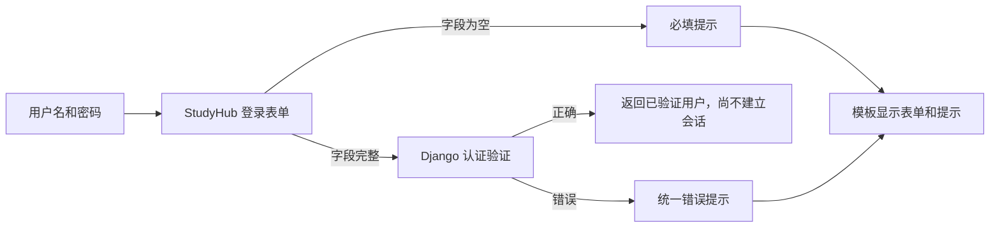

# M1-L03 · T002：中文登录表单与模板

2026-10-13，依据[已确认登录规范](../../specs/001-login/spec.md)和[任务 T002](../../specs/001-login/tasks.md)，完成本地表单与模板组件。T001 已完成，本次不重复生成配置；登录路由与工作台在 T004 接入。

## 一个概念：表单检查输入，模板显示结果

表单是处理输入的 Python 对象，不只是页面上的方框。它负责检查必填内容，并调用已有认证能力核对用户名与密码；模板将表单渲染成 HTML，显示输入框、标签与提示。

本次的数据流：

在代码中，StudyHubAuthenticationForm 继承 Django 的 AuthenticationForm，保留密码验证逻辑，只定制中文文案与输入框属性。[Django 认证表单说明](https://docs.djangoproject.com/en/5.2/topics/auth/default/#django.contrib.auth.forms.AuthenticationForm)

模板的 `{{ field }}` 会生成输入框，`{{ field.errors }}` 显示该字段的错误。用户名随绑定表单保留；密码输入设置不回填，即使提交过密码，返回 HTML 也不会包含它。密码隐藏为圆点与密码不写回 HTML 是两个不同的行为。[Django 密码输入说明](https://docs.djangoproject.com/en/5.2/ref/forms/widgets/#passwordinput)

## 本次结果

| 输入或操作 | 组件预期与检查结果 |
|---|---|
| 用户名为空 | 「请输入用户名」 |
| 密码为空 | 「请输入密码」 |
| 密码错误、账号不存在或停用 | 都显示「用户名或密码不正确」 |
| 返回错误表单 | 保留用户名，密码输入没有返回值 |
| 正确凭据交给表单 | 返回有效用户；表单自身不创建登录会话 |
| 用户名含 HTML 字符 | 自动转义，不执行为脚本 |

输入框有明确标签、自动填充类型、错误关联与键盘焦点。POST 表单含 CSRF 令牌；`novalidate` 让必填错误交给服务器表单统一显示中文，服务端验证仍保留。没有注册、找回密码或记住我入口。

页面沿用浅蓝区域、暖米色说明与深绿按钮。新增样式只作用于登录组件，首页结构和原有样式规则保持原样。

## 怎样验证与保存

Agent 已运行 25 项测试：9 项表单/模板测试与原有 16 项配置测试。表单测试中的虚构账号只存在于内存测试数据库，不是以后给你操作的人工验收账号。Django 配置检查与迁移一致性检查通过；真实 SQLite 和本地密钥内容及修改时间均未改变。

另用 Edge 检查 1440px、390px 和 320px 下的初始、必填和凭据错误预览，共 9 个组合；无横向溢出，错误提示与空密码显示正确，键盘可以依次移动到用户名、密码、登录。截图是本机独立组件预览，尚无可用的登录网址；你的手机实机反馈留在集成阶段，不用现在操作线上首页验收登录。

独立 Agent 只读审查本次实现，未发现阻止交付的问题。Git 在 `feat/001-login` 保存本地小提交；本轮沿用仓库最新的本地范围，不推送、不创建 PR、不合并或部署。具体提交与证据见[课程日志](../LEARNING_LOG.md)。

这些结果证明表单组件的输入与显示行为；登录、跳转、会话和真实手机流程要在 T004/T007 集成验收，不能把组件测试当作整项功能已经完成。

## 你的聊天练习

可以用一句话描述一个你会验收的结果，例如：

> 当我输错密码，应该看到「用户名或密码不正确」，用户名还在，密码框为空。

也可以让 Agent 解释某行代码：

> 请解释 core/forms.py 里的 super().__init__ 为什么要保留，以及它替我们做了什么。

这些指令发到聊天，不输入 PowerShell；练习为选学，不要求先回答才能继续。

## 下一步

T003 准备两个普通本地验收账号；T004 再接通登录路由与受保护工作台。下一课可以直接发：

> 继续 M1-L03 的 T003。由你确认本地数据库，准备两个普通测试账号，私下保留凭据，检查权限并记录结果。保持本地范围，不推送、不改线上资源，暂不实现 T004。
