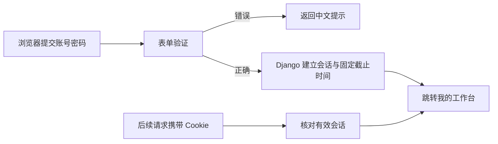

# M1-L03 · T004：登录后进入我的工作台

2026-10-13，依据[已确认规范](../../specs/001-login/spec.md)与[任务 T004](../../specs/001-login/tasks.md)，接通本地登录及受保护工作台。技术实现与 Agent 验证完成；用户实际验收尚未反馈，M1-L03 整课尚未结束。

## 一个概念：验证身份，再建立会话

T002 的表单只告诉我们「凭据属于哪个用户」。本课由登录视图继续调用 Django 的登录能力，把身份存入会话，让浏览器之后可以凭 Cookie 再次访问工作台。

工作台的用户名来自服务端恢复的 user，不来自网址中的 username 或 user_id。URL 是请求地址，不是身份证明；所以把 learner_a 网址参数改成 learner_b，也不会变成账号 B。[Django 登录说明](https://docs.djangoproject.com/en/5.2/topics/auth/default/#how-to-log-a-user-in)

成功登录后仅一次设置「当前时间 + 7 天」的绝对截止时间，刷新和已登录时打开登录页不重新计时。首次写入已验证，完整到期与重启证据在 T005。[Django 会话说明](https://docs.djangoproject.com/en/5.2/topics/http/sessions/#django.contrib.sessions.backends.base.SessionBase.set_expiry)

## 当前可用的本地页面

| 地址 | 行为 |
|---|---|
| http://127.0.0.1:8001/ | 公开首页；提供登录或工作台入口 |
| http://127.0.0.1:8001/login/ | 表单与错误提示；已登录时直接进入工作台 |
| http://127.0.0.1:8001/workspace/ | 未登录先去登录；已登录显示本人的用户名 |

Agent 已启动独立本机服务器，保留到你验收；不需要你在 PowerShell 启动。原有 8000 端口进程未被修改或停止。线上 Render 首页尚未发布这轮登录代码。

## 你这次需要做什么（约 2–3 分钟）

账号资料在本机 `D:\developer\studyhub\.tools\qa\local-test-accounts.json`；用其中 accounts → learner_a → password 的值。不要发送密码本身，反馈页面现象即可。

1. 打开本地登录页，先输入 learner_a 与一个错误密码。应显示「用户名或密码不正确」，用户名还在，密码框为空。
2. 使用资料中的正确密码再登录。应进入「我的工作台」，显示「你好，learner_a」。
3. 刷新工作台，再打开登录页。应该保持 learner_a，登录页自动回工作台。
4. 保留账号 A 的普通窗口，在该浏览器的隐私窗口用 learner_b 登录；也可以使用另一款浏览器。它应显示 learner_b，原普通窗口仍显示 learner_a。

如果普通窗口原本已经是 learner_a，保留它，在账号 B 尚未登录的隐私窗口先试错误密码，再用 B 的正确密码登录。两组身份使用「普通窗口 + 隐私窗口」或两款不同浏览器；同一浏览器的普通标签页共用登录，多个隐私窗口也不能当作多个独立会话。暂时没有退出按钮；T006 会接入，不要求现在验收退出。

例如 Chrome 新开的隐私窗口会延续已有隐私会话，全部关闭后才结束；不要仅凭窗口数量判断身份隔离。[Chrome 官方说明](https://support.google.com/chrome/answer/95464)

可复制的**聊天反馈**：

> 本地登录验收：错误提示正常，用户名保留、密码清空；正确登录显示 learner_a；刷新和打开登录页后身份保持；独立窗口显示 learner_b，原窗口仍是 learner_a。

出现不同结果时，报告「操作、预期、实际」即可，无需自行排 Git 或环境。

## Agent 已验证的结果

- 38 项测试通过：13 项新 HTTP 登录测试、9 项表单测试与 16 项配置回归。
- HTTP 覆盖登录、必填、统一错误、密码不回填、固定跳转、身份隔离、CSRF、禁止缓存和首次绝对期限。
- Edge 在实际本机服务检查 16 个流程/布局场景，包含两个独立会话和 1440px、390px、320px 三种宽度；无横向溢出或脚本错误。
- Django 配置与迁移一致性通过；自动测试仅使用内存数据库，真实数据库和密钥未变。
- 实际浏览器登录正常生成本地会话并更新 last_login，这是预期本地使用；密码、权限与线上数据未修改。
- 独立 Agent 只读审查实现与测试，未发现阻止交付的问题。

退出、完整会话到期边界、实际进程重启和手机实机流程尚待后续，不把当前 Agent 验证当作你的实际反馈。A003 的用户名已验证，退出按钮仍待 T006。

## Git 与下一步

在 feat/001-login 保存本地小提交，不推送、创建 PR、合并或部署。记录见[课程日志](../LEARNING_LOG.md)；准备的账号与密码资料、浏览器文件和服务器日志继续被 Git 忽略。

本课验收反馈后推进 T005：用可控时间证明第 7 天过期，并在自有进程验证重启保留有效会话，不要求你等待一周。先处理本课实际发现的问题，再推进后续任务。
