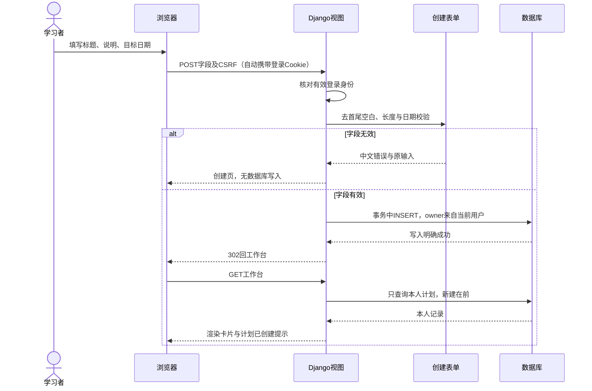

# Implementation Plan: 创建自己的学习计划

**Branch**: `feat/005-plan-create` | **Date**: 2026-10-14 | **Spec**: [已确认规范](spec.md)

**Input**: specs/005-plan-create/spec.md；用户已确认完整行为，业务实施未开始。

**Note**: 本课使用 speckit-plan 生成设计，再由 speckit-tasks 拆任务，不执行应用实现。

## Summary

复用已有 core、登录会话、Django ModelForm 与模板，增加一个 LearningPlan。
创建表单只处理标题、说明、目标日期；服务端验证后指定当前 owner 并保存。
成功回已有工作台，只读取本人计划，展示新卡片和一次性消息。

不用新增运行依赖、独立 API 或服务层。本轮路线及例子不变，技术选择见 [research.md](research.md)。

### 数据从页面到数据库，再回到页面



Cookie 只帮助恢复登录身份，不保存计划内容。数据库才保存目标；
刷新是再次读取，不能再次创建。所属账号由服务器决定，不能相信表单传入 owner。

## Technical Context

**Language/Version**: Python 3.13.14；Django 5.2.17，沿用固定 requirements.txt。

**Primary Dependencies**: Django ORM、ModelForm、messages、事务与测试；标准库 zoneinfo，
已有 tzdata 支持 Windows 时区。Spec Kit 1.2.0 只在独立开发工具环境。

**Storage**: 本地 SQLite；既有生产 PostgreSQL；CI 使用已配置的临时 PostgreSQL 17。

**Testing**: Django TestCase 与必要事务检查；现有 core.tests 自动发现新模块；
隔离文件 SQLite 的真实进程重启、Agent 浏览器和用户实机验收分别记录。

**Target Platform**: Windows 本地 PowerShell、Linux 正式服务；电脑与 >=320px 手机浏览器。

**Project Type**: 服务端渲染的 Django 网页应用。

**Performance Goals**: 满足 SC-001–SC-005 的单次保存、正确卡片与手机操作；
没有新增未确认的时延、吞吐或压测承诺。

**Constraints**: 标题1–100、说明最多1000，均去首尾空白；目标日期按提交时北京时间；
本人数据、POST/CSRF、既有固定七天期限；本课文档设计，不改数据库/生产。

**Scale/Scope**: 当前本地两个测试账号；既定首批5–20人路线。
本功能仅创建与必要工作台卡片，编辑/删除/详情/任务等另做规范。

## Constitution Check

| 规则 | 设计前 | 设计后证据 |
|---|---|---|
| 先确认再实现 | PASS，spec已Confirmed | 原FR/SC与场景不改，任务未勾选 |
| 最小 Django、小步交付 | PASS | 单模型/表单/视图，已有页面，没有新依赖 |
| 服务端身份与数据归属 | PASS | 非空owner、字段白名单、每次本人过滤、CSRF/禁止缓存 |
| 真实证据与用户验收分开 | PASS | 检查计划不等于通过；进程、浏览器、实机、CI分开记录 |
| Git与教学分工 | PASS | 继续同一功能分支/Issue，Agent操作，用户实际使用验收 |

调研已消除技术未知项；设计后复核无例外或违规，没有新增批准流程。
该计划是技术方案，不自动授权完成所有实施任务。

## Project Structure

### Documentation (this feature)

```text
specs/005-plan-create/
├── spec.md
├── checklists/requirements.md
├── plan.md
├── research.md
├── data-model.md
├── contracts/web.md
├── quickstart.md
└── tasks.md
```

### Source Code (repository root)

下列是后续修改/新增的目标，本课不生成应用文件：

```text
core/
├── models.py                       # LearningPlan
├── forms.py                        # LearningPlanCreateForm
├── views.py                        # 创建处理与本人工作台
├── urls.py                         # /plans/new/
├── migrations/0001_initial.py       # 第一份core业务迁移
├── templates/core/plan_create.html
├── templates/core/workspace.html
└── tests/
    ├── test_learning_plans.py       # 结构/关系/排序
    ├── test_plan_forms.py           # 输入/日期边界
    └── test_plan_views.py           # HTTP/保存/账号边界
static/core/styles.css               # 表单/卡片必要布局
```

**Structure Decision**: 沿用现有 core，不新增第二个站点、前端构建或通用仓储层。

## 具体实现决策

### 模型与迁移

字段与约束按 [data-model.md](data-model.md)，title不唯一、空description为字符串、
空target_date为None、owner必填、排序为-created_at/-pk。
声明说明的显式长度validator，不把动态日期限制写到模型或数据库。
新增core的首份迁移及可替换用户依赖，T001只在临时测试库核对；
T003接通页面前明确核对本地SQLite并应用迁移，不更改用户账号。

### 表单与提交

LearningPlanCreateForm 的 Meta.fields 仅 title/description/target_date；
中文标签和精确错误沿用spec。strip先于长度校验；
移除控件原始maxlength以免与规范冲突，表单novalidate由服务端给统一反馈。
DateInput用ISO年月日，动态校验显式取 Asia/Shanghai 的 localdate。
保存实例不来自请求中的id，不使用同名查找后更新。

### 视图、事务与工作台

新增 learning_plan_create，命名core:plan-create，路径/plans/new/。
先登录保护与GET/POST限制，POST使用CSRF；有效表单取未保存实例，owner=request.user，
在atomic中写入，外部捕获DatabaseError并返回原绑定表单的非字段错误。
成功消息只在atomic正常退出后加入，再302到core:workspace。

工作台沿用现有装饰器，只查 owner=request.user 的记录；
保持本人问候和退出，替换待开放区为卡片/空状态并消费成功消息。
读取错误不当作空数据或成功。模板自动转义，说明保留换行，长文本自然换行；
错误关联和触屏尺寸复用M1设计，手机上的表单/日期布局在浏览器实测。

### 验证与交付

按原路线补有意义的测试，不为本课文档运行/编造新业务结果。
T003从接通之时就包含身份/归属，不能先暴露任何用户通用查询。
T004进一步验证US3完整攻击/会话边界，T005验证US2错误/失败体验，
T006做手机布局，T007综合/真实重启/用户验收，T008走完整PR、CI、审查、修复与发布核对。
US1可用结果必须同时具备US3安全规则；不以“仅US1”省去账号边界。

现有M1测试保留，只在新空状态导致纯文案断言变化时更新断言，不削弱认证检查。
CI自动发现core.tests，迁移与静态清单前置沿用，必要部署请求检查在交付任务完善。
不在生产创建验收账号；发布与实际验证按现有流程分别记录，代码回退保留新表数据。

## Complexity Tracking

无违反constitution的复杂性需要豁免；不引入自定义User、复杂架构或新增运行依赖。

## 本课结果与下一步

设计完成，所有实施任务待开始。下一步只做T001：模型、迁移文件与临时库检查；
原本地数据库迁移在T003前置阶段，不能提前改变当前页面或生产。
后续逐任务读取规范、计划、任务和真实Git/活动指针，不自动执行全部清单。
